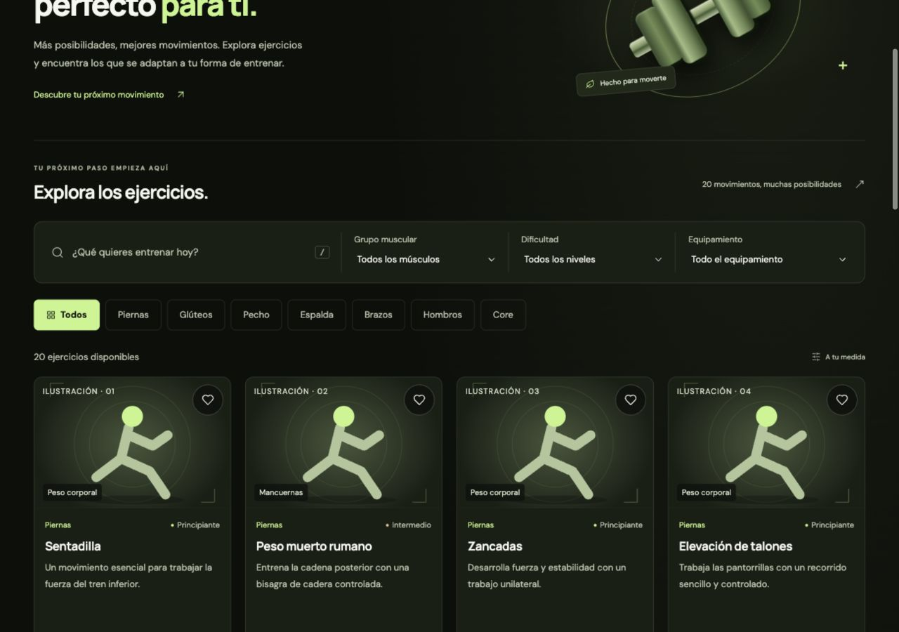

# FitFinder

Descubre ejercicios y construye rutinas a tu medida. Aplicación de portafolio desarrollada con **TypeScript y Vite**, sin framework de UI, backend ni autenticación.



## Funciones

- Catálogo local de 20 ejercicios con búsqueda tolerante a tildes, categorías y filtros combinables.
- Detalle con músculos, equipamiento e instrucciones; panel adaptable con navegación por teclado.
- Favoritos persistentes y vista con búsqueda y filtros.
- Rutinas editables con series, repeticiones, orden de ejercicios y duplicación independiente.
- Confirmación al eliminar y recuperación de la última rutina eliminada durante la sesión.
- Exportación e importación de respaldos JSON, con validación, resumen y confirmación aditiva.
- Estados vacíos, validación de formularios y avisos si el navegador no puede guardar datos.

## Ejecutar localmente

Requiere **Node.js 22** y npm. `.nvmrc` y GitHub Actions utilizan esa versión mayor.

```bash
npm ci
npm run dev
```

Abre la URL que indique Vite. Si utilizas nvm, ejecuta `nvm use` antes de instalar.

| Comando | Resultado |
| --- | --- |
| `npm run dev` | Servidor de desarrollo con recarga automática |
| `npm test` | 32 pruebas de catálogo, filtros, estado, persistencia y respaldos |
| `npm run build` | Comprobación de TypeScript y compilación en `dist/` |
| `npm run preview` | Vista local de la última compilación de producción |

## Arquitectura

```text
src/
  components/           # Controles, catálogo, detalle, rutinas y respaldos
  data/exercises.ts     # Catálogo local tipado
  types/                # Exercise, filtros, Routine y prescripción
  state/                # Operaciones y validación de favoritos/rutinas
  services/             # Almacenamiento protegido y formato de respaldo
  styles/main.css       # Paleta, componentes y diseño adaptable
  filter-exercises.ts   # Filtrado puro, sin dependencias del DOM
  main.ts               # Composición, navegación y eventos
public/                 # Icono e ilustraciones SVG locales
tests/                  # Runner nativo de Node y módulos TypeScript
```

La interfaz se construye con funciones que crean nodos DOM y reciben callbacks. El estado de rutinas se modifica mediante operaciones explícitas; sus consultas devuelven copias. Los datos del usuario se insertan con `textContent`. El almacenamiento se lee como datos desconocidos y se valida antes de utilizarlo.

La navegación usa `#catalog`, `#favorites` y `#routines`, de modo que no necesita reglas de reescritura en el servidor. Los datos se guardan bajo claves versionadas de localStorage.

## Diseño y accesibilidad

Paleta de negro `#0C0F0B`, oliva `#191F15` y lima `#C4F58A`. Tipografías DM Sans y Manrope mediante Google Fonts, con alternativa de sistema. Iconos Lucide e ilustraciones SVG locales identificadas como ilustraciones, compartidas por grupo muscular; no representan la técnica de cada ejercicio.

La interfaz incorpora etiquetas, foco visible, controles con nombres accesibles, estados anunciados y respeto a `prefers-reduced-motion`. El buscador ofrece Ctrl+K o Comando+K y la pestaña identifica la vista activa. El diálogo nativo bloquea la interacción con el fondo, se cierra con Escape y devuelve el foco al disparador. Se han revisado tamaños móviles y escritorio, pero **no se ha realizado una auditoría WCAG completa ni con lector de pantalla**.

## Persistencia y límites

Los favoritos y rutinas pertenecen al navegador y al origen: no se sincronizan entre dispositivos, pestañas o dominios. Un respaldo JSON permite trasladarlos manualmente. La importación conserva los datos existentes y omite rutinas idénticas; admite hasta 1 MB y 100 rutinas por archivo.

Los formularios separan valores guardados y borradores. Guardar persiste nombres y prescripciones; reordenar, duplicar o exportar no guarda automáticamente esos borradores. El historial para deshacer una eliminación se mantiene solo hasta recargar o cerrar la página.

Si localStorage falla, la sesión continúa en memoria y muestra un aviso. En una importación las colecciones se escriben por separado; puede guardarse una y fallar la otra. El mensaje distingue ese resultado de un guardado completo.

## Pruebas y despliegue

Los 32 casos automatizados comprueban catálogo, filtros, persistencia simulada, datos dañados, límites, orden, copias, recuperación y respaldos. Las pruebas no alteran el almacenamiento real del navegador. Las comprobaciones de UI se documentan por etapa; no forman parte de una suite E2E automatizada del repositorio.

GitHub Actions tiene configurados `npm ci`, `npm test` y `npm run build` en Node 22. Su ejecución remota no está verificada en esta entrega. Vercel está configurado para instalar, probar y compilar, con salida `dist`. No necesita variables de entorno.

**La publicación en Vercel está aplazada. No hay una URL pública verificada.** Consulta la [guía de publicación](docs/PUBLICACION.md).

## Documentación

- [Presentación del proyecto y demostración de 90 segundos](docs/PORTAFOLIO.md).
- [Índice de etapas y entregas](docs/ETAPAS.md) y [revisión de producción local](docs/ETAPA-11.md).
- [Explicaciones iniciales de arquitectura, modelos y flujos](docs/DESARROLLO.md).
- [Borradores y legibilidad](docs/ETAPA-6.md), [orden](docs/ETAPA-7.md), [respaldos](docs/ETAPA-8.md), [duplicación](docs/ETAPA-9.md) y [recuperación](docs/ETAPA-10.md).

Consulta la [revisión de teclado, estructura y contraste](docs/ETAPA-12.md) para los cambios y límites de la revisión de accesibilidad.
