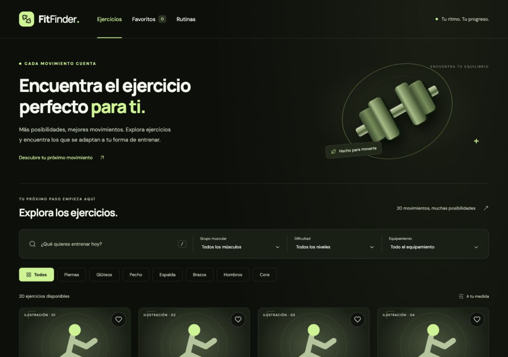

# FitFinder

Aplicación para descubrir ejercicios, guardar favoritos y organizar rutinas. Proyecto de portafolio con Vite, TypeScript estricto, HTML semántico, CSS y Lucide. Sin React, backend ni autenticación.



## Estado: etapa 5 — preparación de publicación

Implementado: catálogo local de 20 ejercicios, búsqueda por nombre sin distinción de tildes o mayúsculas, tres filtros combinables, categorías sincronizadas, contador de resultados, limpieza de filtros y estado vacío. Diseño responsive, atajo `/` para buscar, foco visible y respeto a `prefers-reduced-motion`.

Implementado también: detalle de cada ejercicio con descripción, músculos, equipamiento e instrucciones. Panel lateral en escritorio y modal inferior adaptable en móvil. Apertura mediante tarjeta o teclado, cierre con botón, Escape o clic en el fondo, bloqueo del scroll de fondo y devolución del foco al disparador.

Implementado también: favoritos desde tarjetas y detalle, vista Favoritos con contador, búsqueda y filtros, persistencia con localStorage, validación de datos y avisos si no se puede guardar.

Implementado también: creación, renombrado y eliminación de rutinas, incorporación de ejercicios desde el detalle, edición de series y repeticiones, y persistencia con validación. Paleta actualizada a negro, verde oliva y lima según la referencia visual.

Preparado para publicar: comprobaciones de GitHub Actions, configuración de Vercel y guía en [docs/PUBLICACION.md](docs/PUBLICACION.md). Pendiente: primer commit, subida al remoto y despliegue en las cuentas del propietario. La auditoría con lector de pantalla sigue pendiente.

## Desarrollo

Requisitos: Node.js 22 (se recomienda 22.12 o posterior dentro de esa versión mayor) y npm. `.nvmrc` y CI utilizan Node 22.

```bash
npm install
npm run dev
```

Abre la dirección que Vite muestre en la terminal.

```bash
npm run build
npm run preview
```

`build` comprueba los tipos y genera `dist/`. `preview` sirve esa compilación localmente.

## Arquitectura

```text
public/
  favicon.svg
  images/                   # Ilustraciones SVG originales por grupo
src/
  components/
    exercise-card.ts         # Tarjeta, detalle y favorito
    favorite-button.ts       # Botón y estado accesible
    add-to-routine.ts        # Formulario dentro del detalle
    routines-view.ts         # Crear y editar rutinas
    exercise-detail.ts       # Diálogo accesible reutilizable
    filters.ts               # Controles y categorías
  data/exercises.ts          # 20 ejercicios tipados
  types/exercise.ts          # Modelos y opciones permitidas
  services/storage.ts        # Lectura y escritura protegidas
  state/favorites.ts         # Selección y validación de IDs
  state/routines.ts          # CRUD y validación de rutinas
  styles/main.css            # Paleta, componentes y responsive
  filter-exercises.ts        # Función pura de filtrado
  main.ts                    # Composición, eventos y renderizado
index.html                   # Entrada HTML en español
```

`main.ts` lee los controles y entrega su estado a `filterExercises`. Esta función devuelve los ejercicios que cumplen todas las condiciones; después se actualizan las tarjetas y el contador. Categorías y selector muscular representan el mismo filtro. La búsqueda nunca se inserta como HTML. Las plantillas HTML solo interpolan datos locales de confianza; si se incorpora una API, habrá que renderizar sus textos con `textContent`.

## Modelo y navegación

`Exercise` contiene ID, nombre, descripción, grupo muscular, dificultad, equipamiento, músculos principales, instrucciones e imagen. Los valores de filtros se derivan de listas `as const` para evitar variantes inconsistentes.

En esta etapa: Inicio → Explorar → Buscar/filtrar → Detalle → Volver al catálogo.

Ya disponible: Explorar/Favoritos → Detalle → Guardar o quitar favorito.

Disponible: Detalle → Agregar a mi rutina → Rutinas. `Routine` contiene `id`, `name` e `items`; cada elemento usa `exerciseId`, `sets` y `reps`. La capa de almacenamiento se comparte con favoritos y cada modelo valida sus datos.

## Diseño

Fondo negro `#0C0F0B`, superficies verde oliva `#191F15`, tarjetas e ilustraciones `#293322`, acento lima `#C4F58A`, texto `#F5F7EF` y secundario `#B8C3AC`. La paleta procede de la referencia visual proporcionada por el usuario. Tipografías DM Sans y Manrope mediante Google Fonts, con alternativa local de sistema si no hay conexión. La mancuerna del hero está dibujada con CSS; las imágenes de las tarjetas son ilustraciones locales identificadas como tales, compartidas por grupo muscular. Son recursos decorativos, no demostraciones de la técnica.

## Cómo comprobar el catálogo

1. Al abrir, aparecen 20 ejercicios.
2. Busca `BICEPS`: aparece Curl de bíceps, aunque el nombre tenga tilde.
3. Limpia y elige Piernas: aparecen cuatro ejercicios y se actualiza el selector muscular.
4. Añade Intermedio y Mancuernas: aparece Peso muerto rumano.
5. Cambia a Peso corporal conservando los otros filtros: aparece el estado vacío.
6. Pulsa Ver todos los ejercicios: reaparecen los 20 y el foco vuelve al buscador.
7. Recorre controles con Tab y activa categorías con Enter o Espacio.
8. Prueba anchos de 375, 768 y 1280 px; comprueba que no haya desbordamiento horizontal.
9. Ejecuta `npm run build`: debe terminar sin errores.

## Despliegue en Vercel (al completar las etapas)

1. Sube el repositorio a tu cuenta de GitHub.
2. Importa el repositorio en Vercel.
3. Selecciona Vite como preset, `npm run build` como comando y `dist` como directorio de salida.
4. Publica. Esta versión usa una única página y no necesita reglas de rutas ni variables de entorno.

No se ha publicado ni conectado este proyecto a una cuenta externa.

## Etapa 2: funcionamiento y pruebas

`createExerciseDetail` crea un único `<dialog>` y devuelve `open` e `isOpen`. Cada tarjeta recibe una función `onOpen` y pasa el ejercicio y su botón al panel. El detalle actualiza sus textos con `textContent` y sus listas con nodos DOM. `showModal()` activa la modalidad nativa del navegador: el fondo queda inerte y la navegación de foco permanece dentro del diálogo. El evento `close` restaura el foco y libera el scroll de fondo. El atajo `/` del catálogo se suspende mientras el panel esté abierto.

Archivos de esta entrega: `src/components/exercise-detail.ts` (nuevo), `src/components/exercise-card.ts`, `src/main.ts`, `src/styles/main.css`, este README y `docs/ETAPAS.md`.

1. Haz clic en cualquier tarjeta: debe mostrar el nombre y los datos de ese ejercicio.
2. Recorre el catálogo con Tab y abre un detalle con Enter o Espacio. El foco inicial debe estar en Cerrar detalle del ejercicio.
3. Con Tab y Shift+Tab, comprueba que no llegas a los controles del catálogo mientras el panel está abierto.
4. Pulsa Escape: el foco debe volver al botón de la tarjeta y los filtros deben conservarse.
5. Reabre y prueba el botón de cierre y el clic en el fondo oscuro.
6. Abre otro ejercicio: revisa que cambien título, equipamiento, músculos e instrucciones.
7. En móvil, desplaza el contenido del panel hasta los pasos: el botón de cierre permanece visible y el catálogo no se desplaza.
8. Ejecuta `npm run build`.

Validación realizada: compilación de producción correcta; apertura con clic y Enter; datos de dos ejercicios; cierre con botón y Escape; devolución del foco y liberación del scroll; ancho móvil de 375 px sin desbordamiento horizontal del panel. No se ha realizado una auditoría con lector de pantalla.

## Etapa 3: favoritos

### Archivos

Nuevos: `src/services/storage.ts`, `src/state/favorites.ts`, `src/components/favorite-button.ts` y `tests/favorites.test.mjs`. Modificados: tarjetas, detalle, `src/main.ts`, estilos, configuración de scripts y documentación.

### Cómo funciona

- La capa `storage` captura errores de acceso, lectura, JSON y escritura. Su resultado permite comunicar el fallo sin detener la aplicación.
- `createFavorites` mantiene un `Set` de IDs y guarda un array JSON bajo `fitfinder.favorites.v1`. Solo acepta IDs del catálogo; descarta duplicados y valores inválidos. Si hay datos dañados, avisa y permite iniciar una selección nueva sin sobrescribirlos hasta la siguiente acción de guardado.
- El botón corazón utiliza `aria-pressed` y un nombre que identifica el ejercicio. Es independiente del botón que abre el detalle. Tras actualizar una tarjeta se restaura el foco.
- Las rutas `#catalog` y `#favorites` permiten alternar vistas y utilizar Atrás/Adelante. Los filtros se conservan al alternar vistas y se aplican a la colección seleccionada.
- Mientras el detalle esté abierto, su botón se actualiza sin reconstruir el diálogo ni quitarle el foco. El catálogo se actualiza al cerrarlo. Si la tarjeta desaparece de Favoritos, el foco vuelve al título de la sección.
- Si falla la escritura, la selección continúa funcionando en memoria y un aviso explica que podría perderse al recargar. No hay sincronización entre pestañas en esta etapa; una recarga vuelve a leer los favoritos guardados.

Los favoritos pertenecen al navegador y al origen (protocolo, dominio y puerto). No se comparten automáticamente entre la vista local y Vercel. Borrar los datos del navegador también borra esta selección.

### Cómo probar

1. Guarda dos ejercicios con el corazón. Comprueba el contador de navegación y el estado de cada botón.
2. Abre Favoritos y combina búsqueda o filtros: solo se muestran coincidencias dentro de tus favoritos.
3. Recarga: deben mantenerse los ejercicios guardados y la vista Favoritos.
4. Abre un detalle, quita el favorito y cierra con Escape. La tarjeta desaparece de Favoritos y el foco permanece en la aplicación.
5. Quita el último: aparece Tu selección empieza aquí. Explorar ejercicios vuelve al catálogo completo.
6. Prueba con Tab y Enter/Espacio: el corazón y Ver ejercicio son controles separados.
7. Ejecuta `npm test` y `npm run build`.

Las nueve pruebas automatizadas simulan persistencia, recarga, eliminación, IDs desconocidos, duplicados, tipos inválidos, JSON dañado y errores de acceso/lectura/escritura. No modifican el almacenamiento real del navegador. En navegador se verificaron guardado con teclado, persistencia tras recarga, filtros dentro de Favoritos, eliminación desde el detalle, foco y ancho de 375 px sin desbordamiento horizontal.

## Etapa 4: rutinas y paleta verde/negro

### Archivos y responsabilidades

- `src/types/routine.ts`: contratos `Routine`, `RoutineItem` y `RoutineResult`.
- `src/state/routines.ts`: crea, renombra y elimina rutinas; añade, edita y quita ejercicios. Valida cada operación y los datos leídos de localStorage. Devuelve copias para evitar cambios externos al estado.
- `src/components/routines-view.ts`: formularios de creación, renombrado y prescripción, estado vacío y confirmación visible de eliminación. Los nombres del usuario se insertan mediante `textContent`, nunca como HTML.
- `src/components/add-to-routine.ts`: formulario dentro del diálogo de detalle para elegir una rutina o crearla allí, configurar series/repeticiones y añadir el ejercicio.
- `src/main.ts` y `src/components/exercise-detail.ts`: navegación `#routines`, integración del estado, gestión del foco y acceso al detalle desde las rutinas.
- `src/styles/main.css`, `index.html`, `public/favicon.svg` y `public/images/*.svg`: paleta negro/oliva/lima consistente en interfaz e ilustraciones.
- `tests/routines.test.mjs`: pruebas de operaciones, validación, datos dañados, recarga y errores de escritura.

### Decisiones

La clave es `fitfinder.routines.v1`, separada de favoritos. Nombre: de 1 a 60 caracteres tras recortar espacios. Series: enteros entre 1 y 50. Repeticiones: enteros entre 1 y 100. Un ejercicio aparece como máximo una vez por rutina, con su prescripción editable. Estos límites validan el formato de la aplicación; no son una recomendación de entrenamiento.

Los formularios usan validación HTML y validación del modelo. El guardado se realiza al enviar cada formulario, no en cada pulsación. Si la escritura falla, la sesión sigue funcionando y se muestra un aviso. Al cargar datos se omiten rutinas/ejercicios inválidos y se comunica el problema. La eliminación de una rutina requiere un segundo botón de confirmación dentro de su tarjeta. No hay seguimiento, calendario ni estadísticas.

### Cómo probar

1. En Rutinas, crea una con nombre. Prueba un nombre de solo espacios: debe rechazarse.
2. Abre un ejercicio del catálogo; al final del detalle selecciona esa rutina, escribe 4 series y 10 repeticiones y pulsa Agregar a mi rutina.
3. Intenta añadir el mismo ejercicio de nuevo: debe indicarse que ya existe.
4. En el selector del detalle elige Crear una nueva rutina, dale nombre y añade el ejercicio.
5. En Rutinas, cambia nombre y prescripción; pulsa sus botones Guardar. Recarga y comprueba que se mantienen.
6. Abre el detalle desde el nombre de un ejercicio de la rutina; cierra con Escape y verifica el retorno del foco.
7. Quita un ejercicio. Elimina una rutina; prueba primero Conservar rutina y después Sí, eliminar.
8. Comprueba a 375 px que la página no se desborda y que los formularios y navegación siguen accesibles.
9. Ejecuta `npm test` (13 pruebas) y `npm run build`.

La publicación no se ha realizado. Para desplegar sigue el apartado Vercel anterior. Los datos pertenecen al navegador y origen; no se transfieren entre el servidor local y el dominio publicado. No se sincronizan automáticamente entre pestañas.

## Preparación de publicación

- `.github/workflows/checks.yml` comprueba instalación, pruebas y compilación en Node 22 para pushes a `main` y pull requests. Su ejecución remota queda pendiente de la primera subida.
- `vercel.json` configura Vite con `npm ci`, `npm test && npm run build` y salida `dist`.
- `.nvmrc` fija la versión mayor de Node; `.vercel/` queda excluido de Git.
- `tests/catalog.test.mjs` añade tres casos de integridad y filtrado. El total actual es de 16 pruebas.

Consulta [la guía de publicación](docs/PUBLICACION.md) para los comandos de primera subida y la comprobación del despliegue. No hay una URL de producción verificada todavía.
